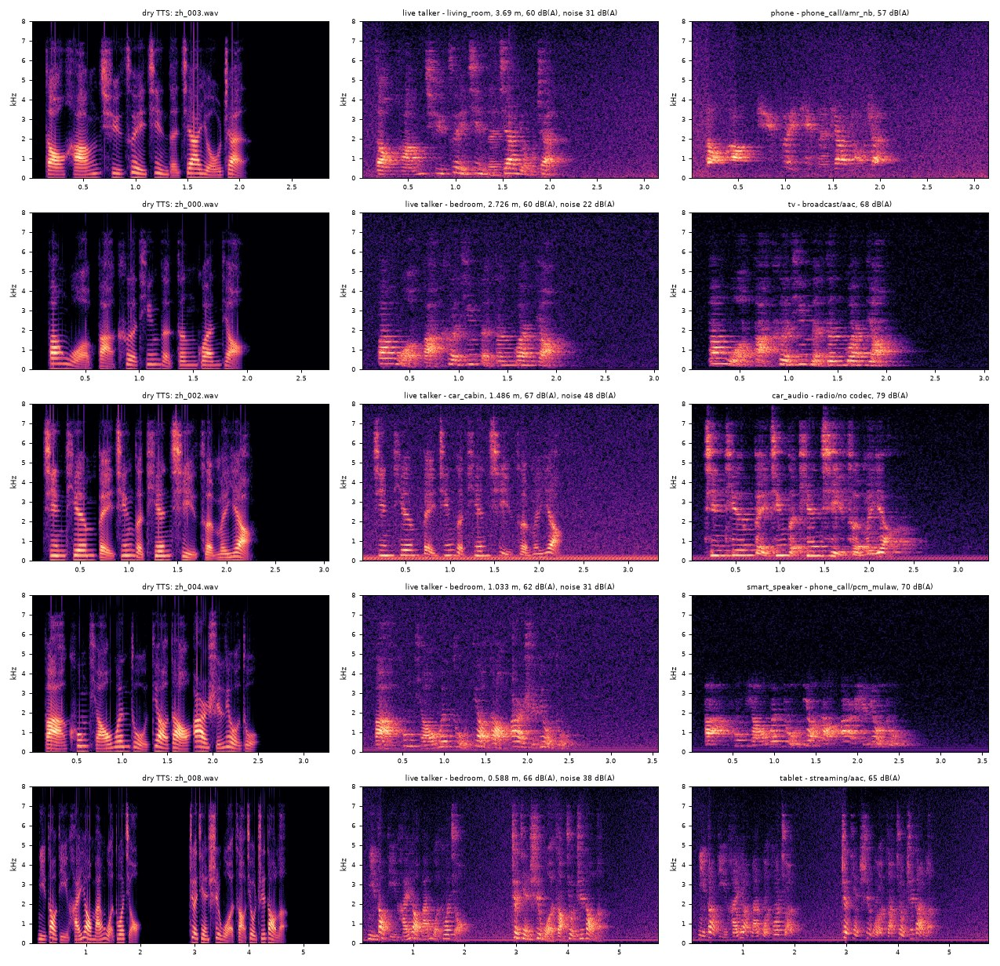
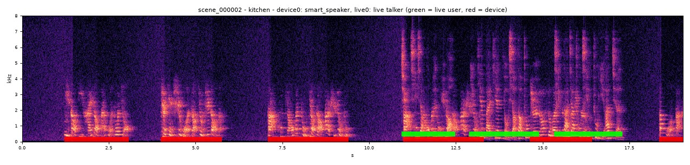

# replay_opus

把 TTS 语音或真人对着麦克风的录音，渲染成两类训练数据，用来训练全双工语音对话系统的**拒识**能力：

- **真人（live，放行）**：一个人在客厅、卧室、厨房或车里，对着设备说出这句话；
- **外放（device，拒识）**：电视、音箱、手机、平板、笔记本、智能音箱、收音机或车机，把同一句话播放出来。外放有三种形式，都标 `device`：
  - **单次外放（`single`）**：制作好的节目播放一次，比如电视、电台、播客；
  - **录音再外放（`rerecorded`）**：有人在别的房间用手机录下来再放，比如短视频、语音消息、免提通话；
  - **同场景二次重放（`replay`）**：有人在这个房间里被手机录下，录音再在这里放出来。

两类放在**同一个场景**里生成：同一个房间、同一组噪声、同一个麦克风、同一条采集链。它们之间唯一的区别是声音是怎么来到麦克风的。设计依据、参数来源和文献汇总见 [`docs/tts-live-playback-rendering.md`](docs/tts-live-playback-rendering.md)。



## 为什么推倒重来

这个仓库原来的代码是给**深伪 / 重放攻击检测**写的（ASVspoof PA、ReplayDF 那一套）。拿它给全双工拒识造数据，有四个根本问题：

1. **只有一类。** 它只把音频变成「重放音」，没有「真人在同一个房间里说话」的对照。模型能学到的最省事的规则就是「有混响、有噪声、音质差 = 外放」。你已经指出这不够用：真人在客厅里说话，同样有混响和噪声。
2. **链路的位置不对。** 编解码器放在了麦克风**之后**，这对应的是「偷录的文件又被压缩」。拒识场景里，编解码发生在扬声器**之前**：电视节目是 AAC/AC-3 播出的，短视频是 Opus/AAC，电话是 AMR/G.711。麦克风之后的处理两类都要经过，不该成为区分依据。
3. **房间不是同一个房间。** 旧代码每条音频独立抽一个 T60/DRR，真人和电视没法放进同一个客厅，也就无从体现「电视在墙边、人在沙发上」这种几何差异。
4. **没有全双工需要的输出形式。** 全双工模型听到的是一条连续的流：电视一直在说，用户时不时插话，经常和电视重叠。它需要这样的流，并且需要带时间戳的标签。

新架构按「共享场景 + 两条发声链」重写，只保留了原来的 DSP 基础件、编解码往返、扫频测量和路径列表这些可复用的部分。

## 架构

```text
                ┌─ 真人：嗓音电平 · Lombard 效应 · 嘴部指向性 ────────────────────────────────────────┐
输入语音 ──────┤                                                                                    ├─→ 同一房间 ─→ 同一噪声 ─→ 同一采集链 ─→ 输出
                └─ 外放：[形式] ─→ 节目链（广播/流媒体/通话/电台）─→ 设备 DSP ─→ 扬声器非线性 ─→ 多单元频响 ┘
                         single：无                    （编解码、响度、压缩、配乐）  （对白 EQ、虚拟低音、AVL、智能功放限幅）
                         rerecorded：远端房间 · 远端手机（降噪、AGC）
                         replay：本地房间 · 附近手机 · 存储编码（不再经过节目链）
```

输入分两种来源。**`dry`**（默认）是 TTS，或者近讲、安静条件下录的真人，当作嘴里发出的声音，两类都能生成。**`recorded`** 是已经在某个房间被某只麦克风录下的真人（手机录音、远场录音、众包录音），它只能变成 `rerecorded` 外放，录音本身就是远端那一段；它的真人版就是它自己。

同一句话的三种外放形式从同一台设备、同一个位置放出来：设备、摆位和房间路径在抽形式之前就已经定好。

**共享的部分**（`scene.py`、`acoustics.py`、`noise.py`、`capture.py`）：

- **房间**：鞋盒模型。早期反射用镜像源法，每个镜像按倍频程计算墙面吸声、空气吸收（ISO 9613-1）和声源指向性；混合时间之后接扩散尾，尾部电平由同一房间按 Barron 修正理论算出。家具和座椅的散射用散射系数建模：每次反射把一部分镜面能量交给扩散场。所以同一场景里的真人和电视共享 RT60，但各自的直达声、早期反射和直混比取决于自己的位置和朝向。
- **环境预设**（`environment.py`）：客厅、卧室、厨房、书房、车舱。每种预设给出房间尺寸、混响、麦克风位置、说话人位置、设备类型的比例和噪声工况。车舱有固定座位（主驾、副驾、后排）和车机扬声器布局（门板低音、A 柱高音、后门同轴，可选中置）。
- **噪声**：以麦克风处的 A 计权声压级给出。家居有安静底噪、空调风扇、电器嗡声、窗外交通；车内有怠速、城市、高速三种工况，由胎噪、发动机阶次、风噪和鼓风机合成。同一场景的噪声对两类完全相同，逐样本一致。
- **采集链**：MEMS 麦克风频响和自噪声、声压到数字满度的映射、前端高通、可选的降噪、AGC、ADC 削波，以及可选的上行编解码。

**不同的部分**，也就是模型真正该学的东西：

| | 真人（`talker.py`） | 外放（`content.py` + `speaker.py`） |
| --- | --- | --- |
| 电平 | 1 m 处 55–66 dB(A)，噪声大时按 Lombard 效应抬高并变亮 | 按设备听音音量设定，噪声大时用户会调大音量。两边都按 P.56 式有效语音电平校准，句间的底噪和配乐不算在内 |
| 喇叭之前 | 无 | `rerecorded`：远端房间、远端说话人、远端噪声、远端手机的采集链；`replay`：同一房间里另一个位置的说话人、附近手机、存储编码 |
| 频带 | 无限制 | 小喇叭高通：手机 400–900 Hz、平板 250–550 Hz、笔记本 180–450 Hz、电视 90–220 Hz；外加谐振峰、腔体峰和箱体起伏 |
| 节目处理 | 无 | 响度归一（-23/-24 LUFS 或 -12~-18 LUFS）、母带压缩、限幅、配乐、原录音房间 |
| 编解码 | 无 | AAC / AC-3 / MP2（广播），AAC / Opus / MP3（流媒体），AMR-NB / G.711 / G.722 / Opus（通话） |
| 非线性 | 无 | 由音量决定：接近最大音量时进入智能功放限幅和振膜非线性 |
| 辐射 | 一个嘴，高频向前 | 多个单元分处不同位置，可以朝下、朝上、朝墙发声 |
| 时间结构 | 零星几句 | 连续节目，可能有多个角色轮流说话 |

所有信号都在物理单位（Pa）下渲染，所以真人、设备和噪声之间的相对电平是物理上自洽的。

## 安装

```bash
python -m venv .venv
.venv/Scripts/python -m pip install -r requirements.txt   # Linux/macOS: .venv/bin/python
python -m replay_opus selftest
```

`av`（PyAV）自带 ffmpeg，上面所有编解码器都**不需要**另装系统 ffmpeg。`selftest` 用答案已知的系统逐项验证：BS.1770 响度、A 计权、房间 RT60 与直混比、所有编解码器往返、扫频测量、成对渲染的共享性质、三种外放形式共用同一台设备、场景标签的位置。

## 输入：一行一条语音

输入是一个文本文件，一行一条，不是文件夹：

```text
tts/zh_000.wav	帮我把客厅的灯关掉。
tts/spk03_0012.wav	spk03	今天北京的天气怎么样？
tts/zh_009.wav
```

每行可以是 `路径`、`路径<TAB>文本` 或 `路径<TAB>说话人<TAB>文本`，也可以用 `.jsonl`，每行写 `{"audio": ..., "text": ..., "speaker": ...}`。相对路径相对于列表文件所在的目录。文本和说话人会原样写进标签。编码接受 UTF-8、带 BOM 的 UTF-8 和 UTF-16。

JSONL 的每一行还可以说明这条输入是什么、要放成哪种外放：

```json
{"audio": "tts/zh_000.wav", "text": "打开客厅的灯"}
{"audio": "tts/zh_001.wav", "text": "今天有雨", "playback": "replay"}
{"audio": "rec/user_17.wav", "text": "帮我定个闹钟", "origin": "recorded"}
{"audio": "tts/zh_002.wav", "playback": {"single": 1, "rerecorded": 2}}
```

- `origin`：`dry` 或 `recorded`。不写就用 `render.origin`，命令行 `--origin recorded` 可以把整份列表设成真人录音。
- `playback`：一个形式名、一个列表或 `{形式: 权重}`。不写就按 `playback.forms` 抽（默认 `single` 0.5、`rerecorded` 0.3、`replay` 0.2），命令行 `--forms replay` 或 `--forms single=2,rerecorded=1,replay=1` 可以整体改。
- `recorded` 输入只能放成 `rerecorded`；写了别的形式，`render` 在开始之前就会报出是哪一条。它的真人版默认不写（`render.recorded_live: skip`）；设成 `passthrough` 会把录音本身按外放版的有效语音电平写进 `live/`，但它和外放版不共享场景，使用前先看文档第 5 节。

`demo/inputs.txt` 是 12 条真实 TTS（Windows 自带的 Huihui / Zira 语音，由 `scripts/make_demo_tts.ps1` 生成），其中既有助手指令也有新闻、剧集、广告式的句子。两类数据来自同一个语音池，所以句子内容本身不会决定标签。

## 用法一：`render`，逐句成对

```bash
python -m replay_opus render --input demo/inputs.txt --output out/pairs --variants 4 --workers 8
```

每条语音、每个 variant 抽一个场景，把同一句话往里渲染两遍：

```text
out/pairs/live/zh_000__v0.wav      真人版
out/pairs/device/zh_000__v0.wav    外放版（同一房间、同一噪声、同一麦克风）
out/pairs/manifest.jsonl           每个文件一行
```

manifest 的主要字段：

| 字段 | 内容 |
| --- | --- |
| `label` | `live` 或 `device` |
| `pair` | 成对 ID：`key#variant`，两类共用 |
| `text` / `speaker` | 从输入列表带过来 |
| `origin` | 输入来源：`dry` 或 `recorded` |
| `playback_form` | 外放行才有：`single`、`rerecorded` 或 `replay`。只是元数据，训练标签仍然是 `label` |
| `at_mic` | 麦克风处的语音 A 计权电平、信噪比、直达声延迟 |
| `scene` | 环境、房间尺寸与分频带 RT60、麦克风位置、噪声工况与电平、采集链参数 |
| `source` | 真人：电平、Lombard、朝向、距离、房间路径（含声学频谱起伏 `sstd_db`）；设备：类型、各单元位置与频响、DSP 设置、节目链（响度、压缩、编解码、配乐），以及 `playback`：形式、远端场景或偷录手机的全部参数、声学部分的频谱起伏 `acoustic_sstd_db` |

`--mode` 可以是 `paired`（默认，两类都出）、`mixed`（每个 variant 按 `render.device_prob` 只出一类）、`live` 或 `device`。

每个 variant 的外放形式按该条输入的 `playback` 或 `playback.forms` 抽取。要看同一场景下三种形式的差别，可以用 `--forms` 各渲染一遍：场景、设备和位置都相同，只有喇叭之前的那一段不同。

吞吐：单进程成对模式约 18 倍实时。这台机器上 8 进程渲染 480 条（约 29 分钟音频）用时 19 秒，约 90 倍实时。

## 用法二：`scenes`，全双工流加时间标签

```bash
python -m replay_opus scenes --input demo/inputs.txt --output out/scenes --count 1000 --workers 8
```

每个场景是一条 10–24 秒的流。可能有一台设备在播节目（「电视本来就开着」的连续节目，或一段短视频式的突发），也可能有用户零星说一到三句，并且经常和设备的声音重叠：



manifest 每行一个场景，标签有两层，时间都是语音**到达麦克风**的时刻：

- `utterances`：每条放进场景的语音一项，带角色、声源、设备、节目类型、外放形式（`playback_form`）、文本和说话人；
- `segments`：这些语音内部的语音活动段。一句 TTS 如果中间停顿较长，会分成几段，每段用 `utterance` 指回它所属的那一句，不重复文本。

下面是 `demo/scenes` 里上图那个场景的实际输出（节选）：

```json
{"audio": "scenes/scene_000002.wav", "scene_type": "both", "duration_s": 19.049,
 "utterances": [
   {"start": 7.08, "end": 9.39, "role": "device", "source": "device0", "device": "smart_speaker",
    "content": "phone_call", "utt": "zh_004.wav", "text": "把空调温度调到二十六度。", "speaker": null},
   {"start": 10.929, "end": 17.289, "role": "live", "source": "live0",
    "utt": "zh_007.wav", "text": "据气象部门预报，明天白天有小到中雨，请大家出行注意安全。", "speaker": null}
 ],
 "segments": [
   {"start": 10.929, "end": 12.459, "role": "live", "source": "live0", "utterance": 2},
   {"start": 10.984, "end": 13.294, "role": "device", "source": "device0", "utterance": 3},
   {"start": 12.879, "end": 14.879, "role": "live", "source": "live0", "utterance": 2}
 ],
 "sources": {"device0": {...}, "live0": {...}}, "scene": {...}}
```

场景类型按权重抽取：`both` 0.5、`device_only` 0.25、`live_only` 0.2、`empty` 0.05，可以在 `scene.types` 里改。每个设备声源各自抽一种外放形式。如果输入列表带了说话人，同一场景里用户的声音不会和节目里任何一个角色相同，但每个说话人在整个数据集里两种角色都会出现。`recorded` 输入永远不当用户说话，只进 `rerecorded` 形式的节目，按原样播放。`--stems` 会额外写出每个声源在麦克风处的分轨（按混音同样的增益，但在 AGC、削波和上行编解码之前）。要把 `segments` 转成帧级标签：

```python
from replay_opus import frame_labels
labels = frame_labels(record["segments"], record["duration_s"], frame_s=0.02)
# 0 = 无语音，1 = 仅真人，2 = 仅外放，3 = 重叠
```

## 用法三：`mix`，麦克风里的整段环境声

`render` 把一句话分别做成真人版和外放版。`mix` 要的是麦克风实际听到的那一条：用户和外放可以同时在，噪声和房间也在。四个输入都是文件，也都可以不给。

| 输入 | 是什么 | 不给的时候 |
| --- | --- | --- |
| 用户语音 A（`speech`） | 真人。走嘴、说话电平和指向 | 这段里没有用户 |
| 外放素材 B（`playback`） | 渲染成电子设备外放：按外放形式经过录音环节和节目链、扬声器，再进房间 | 这段里没有外放 |
| 噪声音频（`noise`） | 麦克风处的环境噪声录音 | 用这个场景的合成噪声 |
| 实录房间 RIR（`rir`） | 这一间房的脉冲响应，用户和各个扬声器单元共用它的混响尾 | 用鞋盒房间模型 |

A 和 B 可以来自同一批 TTS，也可以是同一个文件。两条都从时刻 0 开始，在麦克风处叠在一起；较长的那条单独延续到结束。噪声文件会缩放到该场景抽到的 A 计权声压级。实测 RIR 只提供混响尾，直达声和早期反射仍按各个声源的位置和指向性计算（`room.measured_mode: hybrid`）。输出再经过和 `render` 相同的采集链。B 如果是真人录音，用 `--playback-origin recorded` 或 JSONL 里的 `origin`；A 总是真人，必须是 `dry`。`--forms` 同样适用于 B。

```python
from replay_opus import render_mic

mic = render_mic(
    speech="tts/user.wav",          # A，可省略
    playback="tts/programme.wav",   # B，可省略，可以和 A 同一批 TTS
    noise="noise/hvac.wav",         # 可省略
    rir="irs/living/sofa.wav",      # 可省略
)
# mic.audio 是麦克风信号，mic.meta["segments"] 里 role 为 live 或 device
```

批量渲染用四个列表，每一个都可以不给。写法和「一行一条语音」相同；A、B 的列表还可以带文本和说话人。按行对齐：第 i 条混音取每份列表的第 i 行，较短的列表从头循环。条数默认是最长那份列表的行数，`--count` 可以改。四份列表都空着时，必须给 `--count`，出来的是只有合成噪声和鞋盒房间的空场景。同一份列表可以同时当作 A 和 B。

```python
from replay_opus.mix import main

main(
    speech_list="user.txt",
    playback_list="device.txt",
    noise_list="noise.txt",
    rir_list="rirs.txt",
    output="out/mix",
)
```

```bash
python -m replay_opus mix --speech-list user.txt --playback-list device.txt --noise-list noise.txt --rir-list rirs.txt --output out/mix
```

```text
out/mix/mix_000000.wav
out/mix/manifest.jsonl          每个混音一行，segments 的时间是到达麦克风的时刻
out/mix/config.yaml
```

`segments` 转成帧级标签的方式和 `scenes` 相同，`frame_labels` 直接吃这份清单里的 `segments`。

## 防捷径设计

拒识模型会学训练集里最便宜的区分特征。这里刻意让下面这些**不能**用来区分两类：

- **内容和音色**：两类来自同一个 TTS 语音池；成对模式下连句子都相同。
- **房间、噪声、麦克风、前端**：同一场景共享，噪声逐样本一致。
- **电平**：设备音量和人声电平的分布是按麦克风处的实际声压校准过的。车舱会额外带来约 7 dB 的混响增益，车机的电平已经把这一点算进去了。
- **时长和起始静音**：成对的两个文件等长，语音到达麦克风的时刻只差各自的传播距离；编解码器的预读延迟按互相关对齐掉。

同时保留了难例：条形音箱和智能音箱近距离播放（难负例）、远处背对设备的用户、70 dB(A) 车噪下的用户（难正例）、贴着手机录的短视频（录音再外放里最接近单次外放的一种）。

`audit` 命令逐个特征检查有没有漏网的捷径。它计算每个简单特征单独区分两类的 AUC（0.5 表示没有信息）：

```bash
python -m replay_opus audit --manifest out/pairs/manifest.jsonl
```

默认配置下 12 条语音 × 20 个场景（240 对、480 个文件，三种外放形式按默认比例）的实测结果：

```text
feature             kind          AUC        live      device
level_dbfs          nuisance    0.569     -33.967     -32.126
peak_dbfs           nuisance    0.487     -15.253     -15.450
duration_s          nuisance    0.500       3.625       3.625
noise_floor_dbfs    nuisance    0.552     -53.731     -49.502
lead_s              nuisance    0.510       0.175       0.175
crest_db            acoustic    0.262      18.994      16.235
...
level AUC by environment: bedroom 0.58, car_cabin 0.59, kitchen 0.54, living_room 0.56, study 0.60
level AUC by playback form (vs all live): replay 0.63 (n=46), rerecorded 0.61 (n=73), single 0.52 (n=121)
paired level difference device - live: mean +1.5 dB, sd 5.1, 10-90% [-4.1, +9.0] over 240 pairs
acoustic spectral spread, median [10-90%] dB: device:replay 6.0 [5.2, 7.4],
    device:rerecorded 7.2 [6.1, 7.8], device:single 5.2 [4.2, 5.6], live 5.0 [4.0, 5.5]
```

电平、峰值、时长、底噪和语音起始时间这几个「无关特征」都在 0.5 ± 0.2 以内，每个环境内部也是。`rerecorded` 和 `replay` 的电平 AUC 略高，因为它们把录音时的底噪一起放了出来：麦克风处语音电平的配对差中位数只有 −0.3 到 +1.1 dB，底噪的配对差中位数则是 `rerecorded` +1.9 dB、`replay` +1.3 dB。这是物理上应有的差异，但大小取决于远端噪声的设定。波峰因数偏低（AUC 0.26）来自节目压缩和功放限幅。声学部分的频谱起伏（SSTD）和房间声学理论一致：一个房间约 5.6 dB，两个房间串联约 8 dB；几种外放形式的区间彼此覆盖，这也是它们共用一个标签的原因之一。改了预设之后要重新跑一次 `audit`；`scripts/plot_manifest.py` 可以把两类的电平、信噪比、距离分布叠起来画出来。

## 用第三方重放检测器验收

`judge` 命令用独立训练的开源重放检测器给生成结果打分，回答「外放版到底像不像外放重录」。

```bash
pip install torch --index-url https://download.pytorch.org/whl/cpu   # 只需 CPU
pip install -r requirements-detect.txt
python -m replay_opus judge --manifest out/pairs/manifest.jsonl
```

权重在第一次运行时下载到 `~/.cache/replay_opus/detectors`，可以用环境变量 `REPLAY_OPUS_CACHE` 改位置。

### 输入格式

`judge` 读 `render` 写出的 `manifest.jsonl`。要带阳性对照时，还要读当时那份 `config.yaml`。`--reference` 是可选的第三份：你自己录的、已经标好类别的录音。

#### `manifest.jsonl`

`--manifest` 指向的文件一行一个 JSON 对象。`judge` 只保留 `label` 为 `live` 或 `device` 的行，再按 `pair` 配成一对。一对在清单里是两行，共用同一个 `pair`。

`render` 写出的每一行都带这些字段，缺了就配不上对，或者建不出阳性对照：

| 字段 | 含义 |
| --- | --- |
| `pair` | 成对 ID，形如 `zh_000.wav#0`。真人版和外放版相同 |
| `label` | `live` 或 `device` |
| `audio` | 渲染结果的路径，相对 manifest 所在目录 |
| `input` | 渲染前的原始语音。算 `dry` 和重放阳性对照时会重新打开它，这个路径得还在 |
| `key` | 这条语音在输入列表里的名字 |
| `variant` | 第几个场景。和 `key`、渲染时的配置一起决定房间 |
| `scene` | 场景。`scene.room` 用来核对重建出来的是不是同一个房间，`scene.environment` 用来按环境汇总 |
| `source` | 声源。外放行的 `source.device` 用来按设备汇总 |

`text`、`speaker`、`at_mic` 留在文件里，打分不用。下面是一对里的两行，`scene` 和 `source` 只留了 `judge` 会读的字段：

```text
{"audio": "live/zh_000__v0.wav", "input": "D:/data/tts/zh_000.wav", "pair": "zh_000.wav#0", "label": "live", "key": "zh_000.wav", "variant": 0, "scene": {"environment": "living_room", "room": {…}}, "source": {"role": "live", …}}
{"audio": "device/zh_000__v0.wav", "input": "D:/data/tts/zh_000.wav", "pair": "zh_000.wav#0", "label": "device", "key": "zh_000.wav", "variant": 0, "scene": {"environment": "living_room", "room": {…}}, "source": {"role": "device", "device": "tv", …}}
```

`scenes` 和 `mix` 的清单是一条流加时间标签，没有 `pair` / `label` 这一对字段，不能交给 `judge`。

阳性对照会按 `key`、`variant` 和 `config.yaml` 把场景重建一遍，再用 `scene.room` 核对。`config.yaml` 默认读 manifest 旁边那份，也就是 `render` 存下来的；不在旁边就用 `--config` 指过去。`--no-controls` 只给清单里已经写好的音频打分，不再重建场景，这时可以不提供配置。

#### 真实录音：`--reference`

写法和语音列表相同。一行一条，相对路径相对这份列表所在的目录，空行和以 `#` 开头的行跳过，编码接受 UTF-8、带 BOM 的 UTF-8 和 UTF-16。第二列是类别，不是转写文本：

```text
rec/user_01.wav	bonafide
rec/tv_01.wav	spoof
```

`.jsonl` 也可以，类别写在 `text` 里：

```json
{"audio": "rec/user_01.wav", "text": "bonafide"}
{"audio": "rec/tv_01.wav", "text": "spoof"}
```

认作重放的写法：`spoof`、`replay`、`device`、`fake`、`1`。认作真人的写法：`bonafide`、`bona_fide`、`genuine`、`live`、`real`、`0`。大小写不敏感。两列都要有，空标签会报错。

### 调研结论：重放检测没有真正意义上的开源 SOTA

截至 2026 年 9 月，情况如下：

- **真实重放录音上的最好成绩都没有公开权重。** 在 ASVspoof 2021 PA（真实房间、真实设备录制）评测集上，已发表的最好 EER 约 22–28%：压缩辅助特征约 22.7%，用 RIRplay 训练（TIFS 2026）28.04%。两者都只公开了论文或数据。
- **能下载到权重的重放检测器只有两类。** 一类是 ASVspoof 2021 官方基线 LFCC-LCNN 和 JHU ASSERT 这类用 2019 PA **仿真**数据训练的模型，其中官方 LFCC-LCNN 在真实评测集上的 EER 是 44.77%，接近随机；另一类是社区上传的 wav2vec2-base，在 ASVspoof 2021 PA **真实录音**上微调，自报准确率 92.8%，但数据划分方式没有公开。
- **EchoFake（ICASSP 2026）和 ReplayDF（Interspeech 2025）只公开了数据和训练代码。** ReMASC（有车内环境）只有多通道训练代码，都没有权重。
- **W2V2-AASIST、XLS-R-SLS、AntiDeepfake 这些排行榜上的 SOTA 是深伪检测**（合成语音 vs 真人），不是重放检测。我们的两类都是 TTS，这些模型用不上。

所以 `judge` 接入了能拿到的两个重放检测器：

| 名称 | 模型 | 训练数据 |
| --- | --- | --- |
| `asvspoof21-pa-lcnn` | ASVspoof 2021 官方 PA 基线 LFCC-LCNN | ASVspoof 2019 PA（仿真重放） |
| `w2v2-pa21` | wav2vec2-base 分类器（`Vansh180/deepfake-audio-wav2vec2`，固定版本） | ASVspoof 2021 PA（真实重放） |

官方基线的原始代码依赖 2021 年的 PyTorch 接口（`torch.rfft` 和旧版 `torch.stft`），这里按原结构重写并加载官方权重，逐样本和原始实现对比，差异小于 1e-6。

### 这些检测器学的不是「嘴 vs 喇叭」

ASVspoof PA 里的 bona fide 本身就是一只高保真扬声器在房间里播放一次；spoof 是「被攻击者在另一个位置录下来，再用另一台设备放一次」，也就是经过两次声学传播。所以这些检测器学到的是**第二遍录音**留下的痕迹，而电视播演播室节目只经过一次喇叭和一次房间。

因此单看分数没有意义。`judge` 会重建每一对样本所在的场景，在同一个场景里比较四个条件：

| 条件 | 内容 |
| --- | --- |
| `dry` | 原始 TTS，没有房间 |
| `live` | 渲染出的真人版 |
| `device` | 渲染出的外放版 |
| `replay` | 阳性对照：把真人版在同一个麦克风处录下来，再用同一台设备、在同一个位置放一遍，也就是 ASVspoof 定义的重放攻击 |

报告里最关键的是同场景配对胜率：同一个场景里，外放版的分数比真人版更「像重放」的比例。

### 实测结果

用 `demo/inputs.txt` 的 12 条语音，每条渲染 20 个场景，共 240 对（`render --variants 20`，默认配置和种子）：

| | 官方 LFCC-LCNN（仿真训练） | wav2vec2（真实录音训练） |
| --- | --- | --- |
| 阳性对照：replay 比 live 更像重放 | 88%（95% CI 83–91%），AUC 0.78 | 79%（73–84%），AUC 0.70 |
| **外放版比真人版更像重放** | **72%（66–77%），AUC 0.66** | **65%（58–70%），AUC 0.61** |
| 外放 − 真人的中位分差，对照 replay − 真人 | +0.67，对照 +1.77 | +0.18，对照 +0.54 |
| 真人版比干净 TTS 更像重放（live>dry AUC） | 0.00（干净 TTS 被判成极像重放） | 0.98（带混响和噪声就更像重放） |

按设备看外放胜率：官方 LCNN 下笔记本、平板 81%，蓝牙音箱 80%，智能音箱 79%，手机 78%，电视 66%，条形音箱 57%，车机 56%；wav2vec2 下条形音箱 86%，电视 80%，智能音箱 79%，车机 55%，手机 57%。按环境看，两个检测器都是车舱最低（60% / 56%）。

怎么读这些数：

1. **两个检测器都通过了阳性对照**：它们在我们的场景里能认出真正的二次重放，所以它们对外放版的判断有参考价值。
2. **两个独立训练的检测器，包括在真实重放录音上训练的那个，都在同一场景里把外放版判得比真人版更像重放，而且显著高于随机**：置信区间都不含 50%。
3. **幅度只有真正二次重放的约三分之一到五分之二。** 物理上本该如此，因为外放只经过一次传播。不要为了让这些检测器打高分，把外放数据往「二次录音」的方向调：那会把数据带偏到 ASVspoof 的伪影上，而不是更像真实的电视和手机外放。
4. **车机最难分。** 全频多单元、座舱混响短、噪声大，而且 ASVspoof 的训练数据里没有车舱。这部分最需要真实车内录音来验证。
5. **干净 TTS 那一行说明了为什么不能直接拿原始 TTS 当真人类。** 官方 LCNN 把干净 TTS 判成极像重放；wav2vec2 则把一切带混响和噪声的音频都判得更像重放。两类放进同一个场景后，这两种偏差都被抵消了。

### 这个验收的分量有多重

有限。两个检测器本身在真实重放上的表现一般，学的也是另一种「重放」。要得到确凿的结论只有一条路：准备一份**真实录制**的对照集，用 `--reference` 一起打分：

```bash
python -m replay_opus judge --manifest out/pairs/manifest.jsonl --reference real.txt
```

`real.txt` 每行是 `路径<TAB>bonafide` 或 `路径<TAB>spoof`。报告会给出每个检测器在这份真实数据上的 AUC；如果某个检测器在你的真实数据上本身就分不开两类，它对仿真数据的判断也就不作数。真实数据可以自己录，一两百条就够，也可以申请 ASVspoof 2019 real PA（需签协议）或 ReMASC（含车内）。有了真实数据以后，更可靠的「法官」是在真实数据上训一个轻量探针（冻结的自监督特征加线性分类器），CPU 上就能完成。

## 配置

`configs/default.yaml` 就是全部内置默认值，每一项都有注释。环境、设备、节目链这三张预设表写在代码里，用下面的命令打印当前生效的版本：

```bash
python -m replay_opus presets --section devices
```

YAML 里只需要写要改的东西，预设会做深合并；任何一项也都可以在命令行用 `--set` 临时覆盖：

```yaml
environments: {car_cabin: 1.0}                 # 只要车舱
environment_presets:
  car_cabin: {drive_side: right}               # 右舵
devices:
  presets:
    tv: {level_dba: [60.0, 72.0]}              # 电视开得更响
content:
  profiles:
    streaming: {bed_prob: 0.8}                 # 流媒体更常带配乐
playback:
  forms: {single: 0.4, rerecorded: 0.4, replay: 0.2}   # 三种外放的比例，都标 device
  rerecorded:
    environments: {living_room: 0.5, bedroom: 0.5}     # 远端只在家里录，不在车里
    distance_m: {default: [0.2, 1.0]}                  # 远端都是贴着手机录的
    capture: {ns_prob: 0.9}                            # 远端手机几乎都开降噪
  replay:
    codecs: {amr_nb: 1.0}                              # 偷录的都存成 AMR
capture:
  ns_prob: 0.5                                 # 你的设备在模型前面跑了降噪
```

`playback.rerecorded.capture` 和 `playback.replay.capture` 是另外两部手机的采集链，写在里面的值覆盖内置默认值，不继承顶层 `capture` 的修改。

```bash
python -m replay_opus render --input in.txt --output out --config my.yaml --set capture.agc_prob=0
```

采样率：内部默认 32 kHz 处理，输出 16 kHz。如果模型吃 24 kHz（例如 Mimi 系编解码器），设 `sr_internal: 48000` 和 `output.sr: 24000`。数据量大时可以设 `output.format: flac`，无损，磁盘占用约为 WAV 的一半。

## 接入真实素材（强烈建议）

合成素材让流程开箱即用，真实素材会明显提高逼真度。每一类都用路径列表接入：

| 素材 | 配置项 | 说明 |
| --- | --- | --- |
| 真人干语音 | 输入列表，`origin: dry` | 近讲、安静条件下录的真人（EARS、VCTK、AISHELL-3 之类），和 TTS 放进同一个语音池，两类一起用 |
| 真人房间录音 | 输入列表，`origin: recorded` | 手机或远场设备录的真人、Common Voice 之类的众包录音，直接当录音再外放的节目源 |
| 环境噪声 | `noise.lists: {home: ..., car: ...}` | 家居、车内的真实底噪录音。电平仍按场景抽取；远端场景和偷录时刻也用它 |
| 配乐 / 音效 | `content.bed_list` | 电视剧、短视频里的人声常压在音乐下面。可用 MUSAN music 之类的音乐库 |
| 实测房间 IR | `room.measured: {living_room: ...}` | 每个子目录算一个房间；同一场景的各个声源从同一个房间的不同位置里抽 IR。默认只取它的混响尾（`room.measured_mode: hybrid`），因为它的直达声属于测量扬声器；`full` 整条使用 |
| 麦克风频响 | `capture.mic_ir_list` | 你的目标设备或 POLIPHONE 之类的手机麦克风 IR；远端手机和偷录手机用 `playback.rerecorded.capture.mic_ir_list`、`playback.replay.capture.mic_ir_list` |
| 实测设备频响 | `devices.measured: {tv: ...}` | 用 `sweep` / `extract` 在设备前 10–30 cm 测得，加载时自动截取前几毫秒以去掉测量房间 |

测自己的电视或手机：

```bash
python -m replay_opus sweep --output sweep.wav          # 用目标设备播放，在正前方 10-30 cm 录音
python -m replay_opus extract --recording rec.wav --output responses/ --name living_tv
```

`extract` 会写出 `living_tv.npz`，把它写进一个列表交给 `devices.measured.tv` 即可。报告里的 `thd_at_sweep_level` 可以拿来核对对应预设的 `thd_full_scale` 范围。

## 验证

- `python -m replay_opus selftest`：安装后的快速自检。
- `python -m pytest tests -q`：149 项测试，检查的都是物理规律和两类之间的不变量，而不是快照（依赖 PyTorch 的两项在未安装时自动跳过）。主要包括：各倍频程 RT60 符合 Eyring 公式（误差在 12% 以内，实测约 5%），直混比随距离的变化符合扩散场理论（2 dB 以内），指向性只改变直达声不改变混响尾，设备输出电平校准到目标值（0.05 dB 以内），失真随音量增大，窄带通话 4.5 kHz 以上能量低于 -35 dB，成对渲染在语音到来之前逐样本一致，场景标签内外的能量差大于 10 dB；三种外放形式都标 `device` 且共用同一台设备和同一个位置，`rerecorded` 经过另一个房间和另一部手机，`replay` 的偷录手机在同一个房间里、离说话人不超过设定距离，`recorded` 输入只出 `rerecorded` 外放；单个房间和两个房间串联的频谱起伏分别在 5.6 和 8 dB 附近，降噪器按设定量压低噪声而不动语音，底噪不改变有效语音电平，实测混响尾拼接后指向性和直混比仍随场景变化；`configs/default.yaml` 与代码默认值一致。
- `python -m replay_opus judge`：用第三方重放检测器做同场景对照验收，见上一节。输入是 `render` 的 `manifest.jsonl`。
- **下游验证只有一条路**：留一小份**真实录制**的评测集，在你目标的真实家庭和车里，分别录真人说话和真实电视、手机的外放。仿真训出的模型在这份集合上的表现，才是唯一能说明问题的指标。公开数据里，ReMASC 录了室内、户外和车内环境下的真人与重放语音，可以作为参照。

## 已知局限

- **单通道。** 输出单个麦克风的信号。如果前端是麦克风阵列加波束形成，空间线索（声源方向稳定、多单元的空间扩展）只能部分体现。
- **鞋盒近似。** 车舱和房间都按长方体计算，低频模态、桌面反射、座椅遮挡没有单独建模，只由散射系数和吸声分布近似。有实测或带家具的仿真房间 IR 时，用它们的混响尾。
- **设备是参数模型。** 频响、失真、DSP 都按设备类型的典型范围随机抽取，指向性用心形族近似。要逼近某款具体产品，就测它的频响。
- **远端噪声按环境预设取。** 录音类外放会把远端或偷录时的底噪一起放出来。如果你的真实外放素材底噪更低，调低远端环境里吵的工况，或者提高远端手机的降噪概率。
- **没有多级外放。** 节目里再套一段外放（谈话节目连线的电话、翻拍电视的短视频）没有单独生成。
- **没有建模回声。** 全双工系统自己播放的声音（AEC 残留）没有包含在内，那需要另外的数据。
- **没有其他真人。** 家里其他人之间的对话同样是「真人」，从声学上无法拒识，需要语义或说话对象判断。
- **TTS 以外的真人嗓音要自己提供。** 模型只从 TTS 学，就没听过真实的声带。把近讲的真人语料按 `dry` 放进同一个语音池，两类一起用。
- **Lombard 效应只建模了电平和频谱倾斜**，没有建模基频和语速的变化。

## 主要参考

- J. B. Allen, D. A. Berkley, *Image method for efficiently simulating small-room acoustics*, JASA 65(4), 1979.
- M. Barron, L.-J. Lee, *Energy relations in concert auditoriums. I*, JASA 84(2), 1988.
- A. Lindau, L. Kosanke, S. Weinzierl, *Perceptual evaluation of model- and signal-based predictors of the mixing time in binaural room impulse responses*, JAES 60(11), 2012.
- ISO 9613-1, *Attenuation of sound during propagation outdoors — Part 1: Calculation of the absorption of sound by the atmosphere*.
- ITU-R BS.1770-4, *Algorithms to measure audio programme loudness and true-peak audio level*；EBU R 128；ATSC A/85.
- ANSI S3.5-1997 / ISO 9921：不同发声力度下的语音声压级。
- ITU-T P.56, *Objective measurement of active speech level*.
- Y. Ephraim, D. Malah, *Speech enhancement using a minimum mean-square error short-time spectral amplitude estimator*, IEEE TASSP 32(6), 1984.
- N. D. Gaubitch, D. Looney, *On the role of room acoustics in audio presentation attack detection*, ICASSP 2024.
- H. Lane, B. Tranel, *The Lombard sign and the role of hearing in speech*, J. Speech Hear. Res. 14, 1971.
- W. T. Chu, A. C. C. Warnock, *Detailed directivity of sound fields around human talkers*, NRC IRC-RR-104, 2002.
- W. Klippel, *Tutorial: Loudspeaker nonlinearities — causes, parameters, symptoms*, JAES 54(10), 2006.
- E. Larsen, R. M. Aarts, *Reproducing low-pitched signals through small loudspeakers*, JAES 50(3), 2002.
- A. Novak, P. Lotton, L. Simon, *Synchronized Swept-Sine: Theory, Application and Implementation*, JAES 63(10), 2015.
- M. E. Ahmed et al., *Void: A fast and light voice liveness detection system*, USENIX Security 2020.
- Y. Gong et al., *ReMASC: Realistic Replay Attack Corpus for Voice Controlled Systems*, Interspeech 2019.
- J. Yamagishi et al., *ASVspoof 2021: accelerating progress in spoofed and deepfake speech detection*, ASVspoof 2021 Workshop.（表 6：PA 基线在真实重放评测集上的 EER，LFCC-LCNN 44.77%）
- J. C. Sanchez-Valera et al., *RIRplay: Generation of a Replay Stereo Corpus for Voice Biometrics Anti-Spoofing*, IEEE TIFS 21, 2026.
- *EchoFake: A Replay-Aware Dataset for Practical Speech Deepfake Detection*, ICASSP 2026.
- N. Müller et al., *Replay Attacks Against Audio Deepfake Detection*（ReplayDF）, Interspeech 2025.
